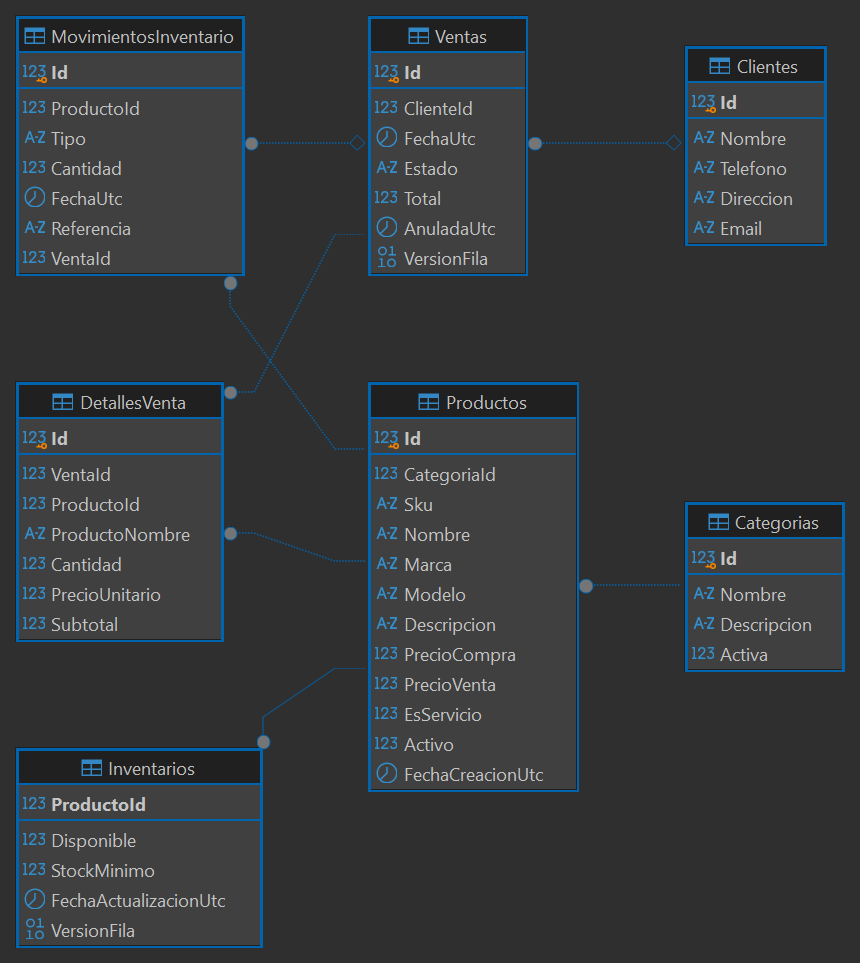

# AMSolucionesCCTV
Proyecto final
# AM Soluciones CCTV - Sistema de Inventario y Ventas

Sistema de inventario y ventas para **AM Soluciones de Cámaras y Seguridad Electrónica**, orientado a la venta de cámaras de seguridad y todos los artículos necesarios para un sistema CCTV (cámaras, DVR/NVR, discos duros, fuentes de poder, cables, conectores, switches PoE y servicios de instalación).

Proyecto final de la asignatura INF-5130, desarrollado en C# con .NET 10, SQL Server y Entity Framework Core.

Autor: Alberto Mercedes Astacio - Matrícula: 100648527

## Estado del proyecto

- [x] Estructura de la solución (Clean Architecture)
- [x] Base de datos y scripts SQL
- [ ] Capa Domain (entidades y reglas de negocio)
- [ ] Capa Application (casos de uso)
- [ ] Capa Infrastructure (EF Core, migraciones, Identity)
- [ ] API REST con JWT
- [ ] Interfaz Razor Pages
- [ ] Pruebas automatizadas con xUnit

## Arquitectura

El proyecto sigue Clean Architecture con cinco proyectos. Las dependencias siempre apuntan hacia adentro, hacia `Domain`.

| Proyecto | Responsabilidad | Depende de |
|
| `AMSoluciones.Domain` | Entidades, reglas de negocio, excepciones personalizadas e interfaces de repositorio | Nadie |
| `AMSoluciones.Application` | Casos de uso (registrar venta, reponer inventario, anular venta), DTOs y servicios | Domain |
| `AMSoluciones.Infrastructure` | Entity Framework Core, SQL Server, repositorios, ASP.NET Core Identity | Application, Domain |
| `AMSoluciones.Api` | API REST con autenticación JWT | Application, Infrastructure |
| `AMSoluciones.Web` | Interfaz con Razor Pages | Application, Infrastructure |

Proyectos de pruebas (xUnit) en la carpeta `tests/`:

- `AMSoluciones.Domain.Tests`
- `AMSoluciones.Application.Tests`
- `AMSoluciones.Infrastructure.Tests`

### Estructura de carpetas

```
AMSolucionesCCTV/
├── src/
│   ├── AMSoluciones.Domain/
│   ├── AMSoluciones.Application/
│   ├── AMSoluciones.Infrastructure/
│   ├── AMSoluciones.Api/
│   └── AMSoluciones.Web/
├── tests/
│   ├── AMSoluciones.Domain.Tests/
│   ├── AMSoluciones.Application.Tests/
│   └── AMSoluciones.Infrastructure.Tests/
├── database/
│   ├── 00_CrearBaseDatos.sql
│   ├── 01_CrearTablas.sql
│   └── 02_DatosIniciales.sql
├── docs/
└── AMSolucionesCCTV.slnx
```

## Base de datos

Motor: SQL Server. Nombre de la base de datos: `AMSolucionesCCTV`.

| Tabla | Descripción |
|---|---|
| `Categorias` | Categorías de productos (cámaras, grabadores, cables, etc.) |
| `Productos` | Catálogo de productos y servicios, con SKU único, precio de compra y precio de venta |
| `Inventarios` | Stock disponible y stock mínimo de cada producto físico (una fila por producto) |
| `Clientes` | Datos de los clientes |
| `Ventas` | Cabecera de la venta: fecha, estado (Completada o Anulada) y total |
| `DetallesVenta` | Líneas de cada venta, con nombre y precio del producto al momento de vender |
| `MovimientosInventario` | Historial de entradas, salidas y anulaciones de stock |

Además, ASP.NET Core Identity creará sus propias tablas (usuarios y roles) mediante migraciones de EF Core.

### Relaciones principales

- Una Categoría tiene muchos Productos.
- Un Producto físico tiene un Inventario.
- Una Venta se compone de uno o más DetallesVenta (composición: un detalle no existe sin su venta).
- Cada DetalleVenta hace referencia a un Producto.
- Cada MovimientoInventario registra un cambio de stock de un Producto.

### Decisiones de diseño

- `DetallesVenta` guarda una copia del nombre y del precio, para que el historial no cambie si el producto se edita después.
- `Inventarios` y `Ventas` incluyen una columna `VersionFila` (rowversion) para el control de concurrencia.
- Los servicios (instalación, mantenimiento) se marcan con `EsServicio = 1` y no tienen inventario.
- El SKU se guarda siempre en mayúsculas.

### Diagrama entidad-relación



## Requisitos

- .NET SDK 10
- SQL Server (instancia local, por ejemplo `localhost:1433`)
- DBeaver (o cualquier cliente SQL)
- Git

## Cómo ejecutar el proyecto

### 1. Clonar el repositorio

```bash
git clone https://github.com/titanacorazado14-code/AMSolucionesCCTV.git
cd AMSolucionesCCTV
```

### 2. Crear la base de datos

Ejecutar, en este orden y desde DBeaver (o cualquier cliente SQL), los scripts de la carpeta `database/`:

1. `00_CrearBaseDatos.sql` (conectado a `master`)
2. `01_CrearTablas.sql`
3. `02_DatosIniciales.sql`

### 3. Compilar la solución

```bash
dotnet build
```

### 4. Ejecutar las pruebas

```bash
dotnet test
```

### 5. Ejecutar la API y la Web

> Pendiente: se completará cuando estén implementadas la cadena de conexión, las migraciones y los usuarios iniciales.

## Reglas de negocio

> Pendiente: se completará al implementar la capa Domain. Reglas previstas:

- No se puede vender más cantidad que el stock disponible.
- La cantidad y el precio deben ser mayores que cero.
- No se puede anular una venta que ya está anulada.
- Una venta debe tener al menos un detalle.
- Anular una venta devuelve el stock al inventario.

## Casos de uso

1. Registrar venta: valida el stock, descuenta el inventario y calcula el total.
2. Reponer inventario: aumenta el stock de un producto y registra el movimiento.
3. Anular venta:cambia el estado de la venta y devuelve el stock.

## Roles de seguridad

- Administrador: acceso completo al sistema.
- Vendedor: registro de ventas y consulta de productos e inventario.

## Uso de herramientas de inteligencia artificial

Se utilizó Claude (Anthropic) como apoyo para planificar el proyecto, diseñar la base de datos y orientar la estructura de la solución. Todo el código incorporado fue revisado y comprendido por el autor antes de incluirse en el repositorio.
